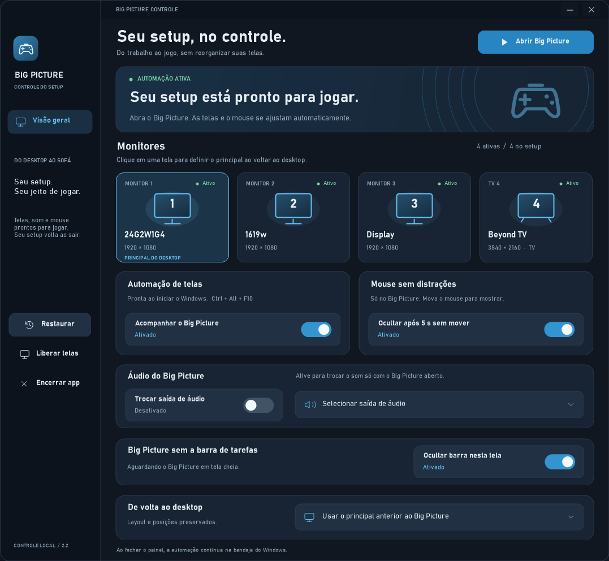

# Big Picture Controle

Automação local para Windows que prepara monitores, áudio e mouse para o Steam Big Picture e restaura o setup ao sair.



## Instalar e usar

Requer **Windows 10 ou 11 de 64 bits**, Steam instalado e monitores em modo **Estender**.

1. Baixe `BigPictureControle-Setup-2.2.0.exe` nos arquivos da versão e execute o instalador.
2. Escolha se deseja iniciar o app junto com o Windows. A instalação é por usuário e não precisa de administrador.
3. Abra o painel e confira o monitor principal de retorno. Se quiser trocar o som no Big Picture, escolha a saída no cartão de áudio.
4. Abra o Big Picture na tela desejada e deixe-o em primeiro plano por dois segundos.

A automação inicia ligada. O **X** fecha apenas o painel; o app continua na bandeja, perto do relógio. Para terminar e restaurar o setup, use **Encerrar app**. É normal haver dois processos: o painel e um auxiliar de recuperação.

O ZIP `BigPictureControle-Portable-2.2.0.zip` permite executar sem instalador. A versão portátil também salva os dados no perfil do usuário, não ao lado do executável.

## O que o app faz

| Recurso | Comportamento |
| --- | --- |
| Monitores | Salva o layout e mantém somente a tela do Big Picture ativa após dois segundos em primeiro plano. O jogo pode assumir o foco. |
| Principal ao voltar | Restaura o principal anterior ou usa a tela escolhida no painel. As posições relativas dos monitores são preservadas. |
| Cursor | Oculta o cursor após cinco segundos sem movimento, somente com automação e Big Picture visível ativos. Mover o mouse o mostra novamente. |
| Áudio | Usa a saída escolhida enquanto a janela do Big Picture existir, inclusive quando estiver em segundo plano. Ao sair ou desativar a opção, restaura as saídas anteriores de reprodução. A saída de comunicações fica independente. |
| Barra de tarefas | Oculta só a barra da tela ocupada pelo Big Picture em tela cheia, mesmo sem foco. Restaura ao minimizar, sair, deixar de ocupar a tela inteira, pausar ou desligar o switch. |

Os recursos de cursor, áudio e barra têm switches próprios. **Liberar telas** pausa a automação e restaura o setup. **Restaurar** também devolve os recursos controlados ao estado anterior e deixa a automação pausada.

Para trocar a tela de jogo, pause a automação, escolha o monitor nas configurações do Steam e ative-a novamente. Clicar nos cartões de monitores define o principal **ao voltar ao desktop**, não a tela escolhida pelo Steam para jogar.

## Atalhos e comandos

| Atalho | Ação |
| --- | --- |
| `Ctrl + Alt + F10` | Pausar ou retomar a automação |
| `Ctrl + Alt + F9` | Ativar ou desativar a ocultação automática do cursor |

O executável aceita os comandos abaixo, que também podem ser usados em atalhos ou em um Stream Deck:

| Comando | Ação |
| --- | --- |
| sem argumento ou `--show` | Abrir o painel |
| `--startup` | Iniciar com a automação ligada e o painel escondido |
| `--resume` | Retomar a automação |
| `--toggle-pause` | Pausar ou retomar |
| `--toggle-cursor` | Alternar a ocultação automática do cursor |
| `--show-cursor` | Mostrar o cursor; a opção automática continua configurada |
| `--restore` | Restaurar o setup e pausar |
| `--exit` | Restaurar e encerrar |

Só uma instância controla o setup. Uma nova chamada envia o comando à instância já aberta.

## Configurações, atualização e recuperação

Configurações, diagnósticos e registros temporários ficam em:

```text
%LOCALAPPDATA%\BigPictureControle
```

O instalador pode ser executado novamente para atualizar. Desinstalar o app preserva as configurações do usuário.

Para importar preferências de uma versão antiga que salvava tudo ao lado do executável, encerre o app antigo e execute a nova versão assim:

```powershell
.\BigPictureControle.exe --import-settings "C:\caminho\da-versao-antiga"
```

A importação copia somente preferências de monitor, áudio e barra que ainda não existam no destino. Não importa logs, flags ou registros de recuperação. Faça isso depois de encerrar o modo de jogo e restaurar o setup na versão antiga.

Durante uma sessão, o app guarda os estados necessários antes das alterações. Se o painel encerrar inesperadamente, o auxiliar tenta restaurar monitores, cursor, áudio e barra. Uma saída HDMI pode levar alguns instantes para reaparecer; a recuperação pendente é mantida para nova tentativa.

**Não exclua registros de recuperação durante uma sessão ou com restauração pendente.** Use o botão **Restaurar** ou `--restore`. Os arquivos `app.log` e `app-status.txt` ajudam a identificar falhas, mas podem conter nomes de dispositivos e caminhos locais; não são incluídos no pacote público.

## Limites conhecidos

- A detecção depende das janelas do Steam identificadas como Big Picture. Mudanças no Steam podem exigir ajustes.
- Os monitores voltam após oito segundos sem Big Picture e sem jogo indicado como ativo pelo Steam. Se o Steam não informar esse estado, use **Restaurar**.
- Monitores duplicados não permitem identificar uma tela física única. Use o modo estendido.
- A restauração de vídeo cobre saídas, posições e modos retornados pelo Windows; não é um backup de HDR ou das posições das janelas de outros aplicativos.
- Jogos que desenham o próprio cursor ou usam uma saída de áudio fixa podem não acompanhar a configuração padrão do Windows.
- O controle da barra é temporário e não altera a opção global de ocultação automática do Windows.
- Há testes automatizados de áudio e barra com dispositivos simulados. Eles não substituem a conferência no hardware e nos jogos usados por cada pessoa.

O app não tem telemetria nem atualização automática. Este é um projeto independente, sem vínculo com a Valve.

## Compilar e testar

O código usa C# e .NET Framework. Os scripts usam o compilador de 64 bits do .NET Framework fornecido pelo Windows; não há pacotes de execução adicionais.

No Windows PowerShell, na raiz do repositório:

```powershell
powershell -NoProfile -ExecutionPolicy Bypass -File scripts\build.ps1
powershell -NoProfile -ExecutionPolicy Bypass -File scripts\test.ps1
```

O executável fica em `build\Release\BigPictureControle.exe`. A configuração `Debug` pode ser escolhida com `build.ps1 -Configuration Debug`.

Para gerar os pacotes, instale o [Inno Setup 6.7.3](https://jrsoftware.org/isdl.php) e informe o caminho do compilador:

```powershell
powershell -NoProfile -ExecutionPolicy Bypass -File scripts\package.ps1 -InnoCompiler "C:\Program Files (x86)\Inno Setup 6\ISCC.exe"
```

O script compila, executa os testes e gera em `dist`:

- `BigPictureControle-Setup-2.2.0.exe`
- `BigPictureControle-Portable-2.2.0.zip`
- `BigPictureControle-Source-2.2.0.zip`
- `SHA256SUMS.txt`

O workflow em `.github/workflows/build.yml` faz o mesmo no Windows do GitHub Actions e disponibiliza os pacotes como artefatos. Ele não publica uma Release automaticamente. O instalador do Inno usado na CI tem versão, hash SHA-256 e assinatura verificados antes da execução.

Os executáveis gerados ainda não têm assinatura digital comercial. O arquivo `SHA256SUMS.txt` permite conferir a integridade dos pacotes distribuídos.

## Organização

```text
assets/                 Ícone e manifesto do app
docs/                   Imagem do painel
installer/              Script do instalador
scripts/                Compilação, testes e empacotamento
src/                    Código-fonte
tests/                  Testes com áudio e barras simulados
.github/workflows/      Compilação automatizada no Windows
```

Arquivos de execução, configurações pessoais e resultados de compilação ficam fora do controle de versão. Envie os fontes ao GitHub e distribua o instalador e o ZIP pela área **Releases**.

## Licença

Ainda não foi definida uma licença de uso e redistribuição do código neste repositório. Escolha uma licença antes de apresentar o projeto como software livre.
